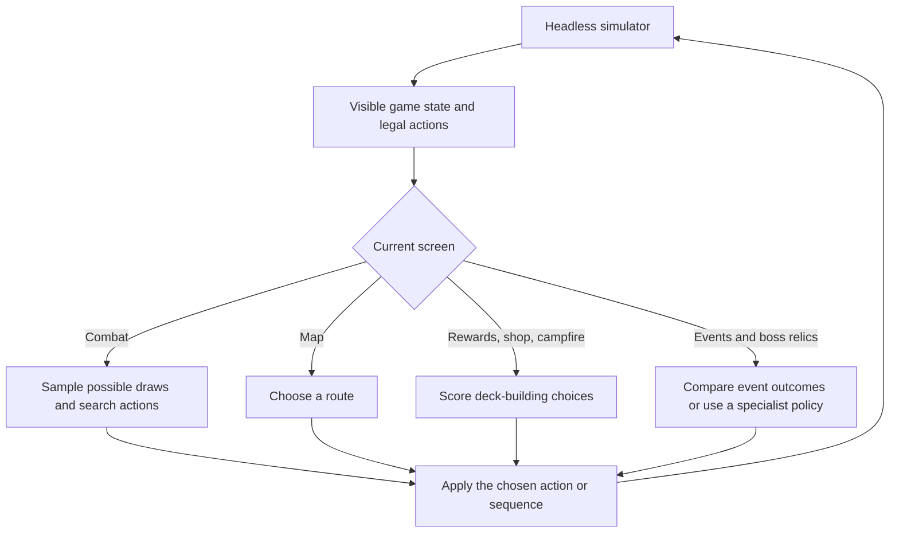

# Spire AI

English · [简体中文](README.zh-CN.md)

Spire AI plays Slay the Spire in a headless simulator. It fights battles,
builds a deck, chooses routes, and handles shops, campfires and events within
the same run. The research goal is to defeat the Act 3 boss as the Ironclad at
Ascension 10 (A10), using only what the player can see in combat and playing
each fight without save/reload.

This repository includes the simulator runner, decision code and trained
weights. The full training pipeline and datasets are kept in the development
workspace.

## How far the agent gets

| Simulator test | Result |
| --- | --- |
| Full runs on 32 A10 Ironclad seeds | 11 cleared Act 1, 2 reached the Act 2 boss, and 0 cleared Act 2 or won the run |
| Combat only, starting from 52 fixed battle positions | 38 wins |

The full-run test starts at the opening choice and uses both combat and
between-battle policies. The combat test starts from prepared battle
positions and measures combat alone.
I suspect that decisions between battles, especially deck building and route
choice, are the main bottleneck. That still needs a controlled comparison.
I have limited time to pursue that work at the moment.

## Quick start

The verified setup uses 64-bit Windows, Python 3.11, CPU PyTorch, MinGW-w64
GCC 13, CMake 3.27 and Ninja. Add Git, CMake, Ninja and MinGW to `PATH`, then
run the following from the repository root in PowerShell. The simulator runs
independently of Steam.

```powershell
python -m venv runtime/venv
$python = "runtime/venv/Scripts/python.exe"
& $python -m pip install torch==2.1.2 --index-url https://download.pytorch.org/whl/cpu
& $python scripts/build_native.py --jobs 4
& $python scripts/play.py --max-actions 12
```

The build reuses the `sts_lightspeed/` submodule when it and its dependencies
are checked out at the pinned revisions. Run `git submodule update --init --recursive`
to initialize them. Otherwise the build uses the checkout in `runtime/sts_lightspeed`,
fetching it when needed. The native module goes into `runtime/native`.
Pass `--source <path>` to `scripts/build_native.py` to use a specific checkout
of the pinned source and dependencies.
[Simulator lockfile](src/spire_ai/simulator-lock.json)

The preview prints one JSON record per action and ends with
`{"actions": 12, "outcome": "action_limit"}`. To start a full run, use the
command below. The last record reports the result.

```powershell
& $python scripts/play.py --seed 20261125
```

## How the agent makes decisions



### Combat

The combat policy takes inspiration from AlphaZero. A learned model guides
Monte Carlo tree search toward promising moves, and a second model estimates
the outcome when a simulation stops before the fight ends. Slay the Spire
adds hidden information, such as which card comes next in the draw pile.
[AlphaZero paper](https://discovery.ucl.ac.uk/id/eprint/10069050/)

1. **Sample possible futures.** If the top card of the draw pile is known,
   each sample puts that card on top and varies the unknown cards subject
   to the other observed constraints. The sampler tracks how supported
   draw-pile operations change those constraints and accounts for multiple
   copies of the same card. The hidden draw order and run seed stay private
   to the simulator. [Public input](src/spire_ai/policy_api.py) ·
   [Draw-order sampler](native/combat_search/ObservedDrawPrefix.h)
2. **Try legal moves across those samples.** The C++ search uses PUCT to
   allocate visits using the model's move suggestions and the results so far.
   Simulations that produce the same actions and visible outcomes share
   tree statistics. If a simulation finishes the fight, that result updates
   the tree. Otherwise the value model estimates win, loss and escape
   probabilities and how much HP and potion value might remain.
   [Search tree](native/combat_search/StandaloneTree.h) ·
   [Value model](native/combat_search/ValueLeaf.h)
3. **Play one move and look again.** The agent usually plays the move with
   the most visits, then searches again from what it actually observes.
   Each decision allows up to 1,024 simulations and 16,384 simulated
   actions. A shortcut can choose the first move of a sequence that the
   visible state proves will win while preserving HP and potions.
   [Move selection](scripts/root_recommendation.py) ·
   [Proven wins](native/combat_search/TerminalProof.h)

### Between battles

- **Deck building.** A shared model scores choices such as taking or skipping
  a card reward, buying an item or removing a card at a shop, and resting or
  upgrading at a campfire. [Deck-building policy](src/spire_ai/construction_policy.py)
- **Routing.** A separate model uses the current run state and route features
  to assign a probability to each available exit, then samples one.
  [Route policy](src/spire_ai/route_behavior.py)
- **Events.** For eligible events that cannot lead to combat, the simulator
  replays choices from the exact same entry state, including its random state.
  The deck-building value model compares the visible results. Events that
  can lead to combat are played straight through.
  [Event search](src/spire_ai/local_event_search.py) ·
  [Event scoring](src/spire_ai/local_event_value.py)

## How the policies were trained

**Combat.** The move model, also called the action prior, learns the
distribution of visits across legal moves in tree search. The value model
learns from fights played to completion. A fixed combat policy plays from
sampled positions, and the result and remaining resources become training
targets. In later rounds, saved public positions can be reused to generate
fresh targets for both models with the combat policy fixed for that round.

**Decisions between battles.** The starting policies learn to imitate human
choices that can be reconstructed from public Slay the Spire run records.
The agent then collects fresh simulator runs with the combat policy fixed
and updates the deck-building and route models using PPO (Proximal Policy
Optimization). Clearing Acts 1, 2 and 3 adds 1, 2 and 3 reward points
respectively, giving early choices feedback from later in the run.
[Human run data](THIRD_PARTY_NOTICES.md)

## Limitations and future training

- **Deck building and routing.** I would first use whole-run results to test
  changes to deck building and routing with combat held fixed. For routing,
  one direction is to train a model that sees the entire reachable map,
  including where paths split and rejoin. Playing different exits from the
  same fork with the subsequent policies held fixed can show how much the
  initial choice matters.
- **Combat on later acts and different decks.** Training data from Acts 2
  and 3 and from decks with developed synergies is sparse. New runs can
  supply those fights so the combat models learn to use the decks the run
  policy builds. The current combat value model also approximates the value
  of remaining potions.
- **Simulator coverage.** The runner can stop with an error if a run
  encounters an unsupported mechanic.

To measure progress, compare one policy change at a time on held-out seeds
with the same combat search budget. Track act clears and three-act wins, and
use HP loss and potion use to help explain the results.

## Policy entry points

| Decision | Entry point |
| --- | --- |
| Whole run | [`FrozenPolicy.play`](scripts/play.py) |
| Combat | [`Combat.choose`](scripts/play.py), [C++ search tree](native/combat_search/StandaloneTree.h) |
| Route | [`sample_route`](src/spire_ai/route_behavior.py) |
| Deck building | [`ConstructionPolicy`](src/spire_ai/construction_policy.py) |
| Events and boss relics | [Event search](src/spire_ai/local_event_search.py), [specialist policies](src/spire_ai/canonical_event_dispatch.py) |

`scripts/` contains the build and play commands and their runtime adapters.
`src/spire_ai/` contains reusable Python policies and simulator interfaces.
`native/combat_search/` contains the C++ combat search. `models/` contains
the trained weights and their loading configuration.
[Model manifest](models/manifest.json)

The project uses the MIT license. The third-party notices cover simulator
dependencies and the source of the human run data.
[License](LICENSE) · [Third-party notices](THIRD_PARTY_NOTICES.md)
