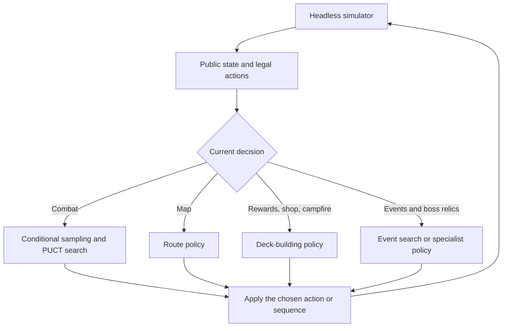

# Spire AI

English · [简体中文](README.zh-CN.md)

Spire AI is an experimental Slay the Spire agent. The goal is to clear the
first three acts as the Ironclad at Ascension 10 (A10), with combat decisions
based only on public information and no save/reload. The release runs in a
headless simulator and includes the inference code and trained weights for
combat and decisions between battles. This README describes how the models
were trained and evaluated. The full training pipeline and datasets are kept
in the development workspace.

## Research approach

### How a decision reaches the simulator



### Combat with hidden information

The combat policy takes inspiration from AlphaZero. A learned policy guides
Monte Carlo tree search, and a learned value model evaluates positions at the
leaves. We adapt the search to Slay the Spire by sampling outcomes compatible
with the information available to the player.
[AlphaZero paper](https://discovery.ucl.ac.uk/id/eprint/10069050/)

1. **Sample hidden states.** The simulator holds the run seed and actual draw
   order. The search uses observations such as cards already drawn and cards
   placed on top of or under the draw pile. For supported shuffle and insertion
   mechanics, the sampler tracks the resulting order constraints and draws
   from the conditional distribution. When several copies of a card could
   explain a draw, it accounts for each possibility.
   [Public input](src/spire_ai/policy_api.py) ·
   [Conditioning on observed draws](native/combat_search/ObservedDrawPrefix.h)
2. **Search several decisions ahead.** The C++ search uses PUCT to allocate
   visits among legal actions, guided by the learned prior and the results so
   far. Samples with the same public action and observation history share tree
   statistics. If a simulation ends the fight, the search backs up that
   outcome. At other leaves, it uses the model's predictions for losses, wins,
   escapes and the distribution of remaining resources. The resource score
   combines HP with an approximate value for remaining potions.
   [Search tree](native/combat_search/StandaloneTree.h) ·
   [Leaf evaluator](native/combat_search/ValueLeaf.h)
3. **Act once, then search again.** The agent usually selects the action with
   the most completed visits and uses outcome and resource estimates to break
   ties. When the public state proves that a sequence can win while preserving
   HP and potions, the search can select its first action directly. Each
   decision has a budget of up to 1,024 simulations and 16,384 simulator steps.
   The agent searches again from the state it actually observes after acting.
   [Root selection](scripts/root_recommendation.py) ·
   [Terminal proof](native/combat_search/TerminalProof.h)

### Training and decisions between battles

- **Combat training.** The action prior learns from search visit counts.
  To train the value model, a fixed combat policy plays sampled battles to
  completion and records the outcome and remaining resources. Each training
  round can revisit stored public positions and recompute their targets
  with the policy fixed for that round.
- **Deck building and routing.** Training starts from decisions that could
  be reconstructed from human run records. The deck-building policy shares
  one model across card rewards, shops and campfires. A separate route policy
  samples a legal exit using public run and route information. In joint PPO
  training, clearing Acts 1, 2 and 3 adds 1, 2 and 3 reward points respectively,
  so choices made early in the run can learn from later results.
  [Construction policy](src/spire_ai/construction_policy.py) ·
  [Route policy](src/spire_ai/route_behavior.py)
- **Events.** For eligible events with no combat, the simulator can restore
  the same entry state to compare choices. The deck-building value model
  scores the public state at the end of each branch. Events that can lead
  to combat are played straight through.
  [Event eligibility and search](src/spire_ai/local_event_search.py) ·
  [Event exit scoring](src/spire_ai/local_event_value.py)

## Research progress and limitations

The table shows results for the released policies on 32 A10 Ironclad seeds.

| Result | Runs |
| --- | ---: |
| Cleared Act 1 | 11/32 |
| Reached the Act 2 boss | 2/32 |
| Cleared Act 2 | 0/32 |
| Cleared the ordinary three-act run | 0/32 |

In a separate evaluation from fixed combat positions, the combat policy won
**38 of 52** fights. The full-run results leave performance in the later acts
largely unmeasured.

- **Combat value.** The value model uses a compact public representation.
  Detailed uncertainty about card order is handled by the sampler, and the
  value of unused potions is an approximation.
- **Route evaluation.** We ran 78 continuations from 19 forks late in Act 2,
  changing the first exit and using fixed policies from then on. At five
  forks the exit changed how often the agent reached the boss. At just one
  fork it changed how often the agent won the fight. That left too few
  examples to train the model that encodes the full reachable map.
- **Coverage.** Data from the later acts and from decks with well-developed
  synergies are still sparse. The runner can stop with an error when it
  encounters a mechanic outside its supported scope.

## Quick start

The verified setup uses 64-bit Windows, Python 3.11, CPU PyTorch,
MinGW-w64 GCC 13, CMake 3.27 and Ninja. Add Git, CMake, Ninja and the MinGW
toolchain to `PATH`. Run the following from the repository root in PowerShell.

```powershell
python -m venv runtime/venv
$python = "runtime/venv/Scripts/python.exe"
& $python -m pip install torch==2.1.2 --index-url https://download.pytorch.org/whl/cpu
& $python scripts/build_native.py --jobs 4
& $python scripts/play.py --max-actions 12
& $python scripts/play.py --seed 20261125
```

The build script checks out the simulator fork and its dependencies at the
pinned versions, then builds the module under `runtime/native`. A checkout
with matching submodules can also be built offline with
`scripts/build_native.py --source <path>`. The simulator runs independently
of Steam. [Simulator lockfile](src/spire_ai/simulator-lock.json)

The 12-action command prints each action and the resulting public-state
fingerprint as a JSON line, then reports `action_limit`. When a run reaches
a terminal state, its last line reports the simulator's result.

## Policy entry points

| Decision | Entry point | What it does |
| --- | --- | --- |
| Whole run | [`FrozenPolicy.play`](scripts/play.py) | Dispatches decisions to the frozen policies and advances the simulator. |
| Combat | [`Combat.choose`](scripts/play.py), [root recommendation](scripts/root_recommendation.py), [native tree](native/combat_search/StandaloneTree.h) | Filters legal actions for potion replacement, runs C++ search, and checks the final recommendation. |
| Route | [`sample_route`](src/spire_ai/route_behavior.py) | Encodes the public route choice and samples a legal exit from the frozen policy. |
| Deck building | [`ConstructionPolicy`](src/spire_ai/construction_policy.py) | Builds and scores menus for card rewards, shops and campfires. |
| Events and boss relics | [event search](src/spire_ai/local_event_search.py), [outside policy dispatch](src/spire_ai/canonical_event_dispatch.py) | Searches eligible pure-choice events and dispatches other event and relic decisions. |

`scripts/build_native.py` and `scripts/play.py` are the command-line entry
points. `scripts/` also contains runtime adapters and validators.
`src/spire_ai/` contains reusable Python components for policies, the
simulator environment and public state.

The inference weights are in `models/`. The `.pt` files contain tensors and
their loading configuration. The native combat models use JSON.
[Model manifest](models/manifest.json)

The project uses the MIT license. The third-party notices cover the simulator
and the sources used to train the models.
[License](LICENSE) · [Third-party notices](THIRD_PARTY_NOTICES.md)
