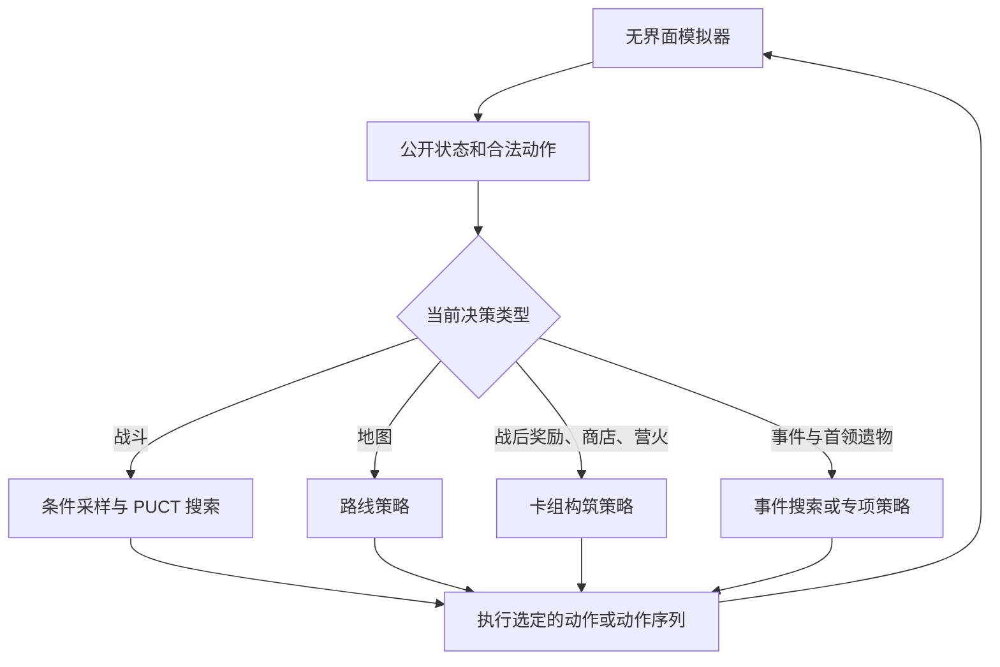

# Spire AI

[English](README.md) · 简体中文

Spire AI 是一个实验性的《杀戮尖塔》AI。项目目标是用铁甲战士打通进阶 10（A10）的普通三幕，
战斗只根据公开信息决策，期间不读档（no SL）。本仓库提供在无界面模拟器中运行的推理代码
和训练好的战斗、局外模型权重。下文介绍训练方法和评估结果。完整训练流程和训练数据留在
开发工作区。

## 算法思路

### 对局决策流程



### 战斗中的不完全信息搜索

战斗策略受 AlphaZero 启发，用策略模型引导蒙特卡洛树搜索，用估值模型评价叶节点。
为处理《杀戮尖塔》的隐藏信息，搜索会采样多种符合玩家已知信息的局面。
[AlphaZero 论文](https://discovery.ucl.ac.uk/id/eprint/10069050/)

1. **根据公开线索采样。** 真实游戏种子和抽牌顺序由模拟器持有。搜索利用已抽出的牌、
   被放到牌堆顶或底的牌等公开线索。对已支持的洗牌和插牌机制，采样器记录这些操作带来的
   牌序约束，再按条件概率生成可能的牌序。抽到一张同名牌时，如果几张副本都符合观察，
   采样器会考虑每种可能。[公开状态接口](src/spire_ai/policy_api.py) ·
   [抽牌条件采样](native/combat_search/ObservedDrawPrefix.h)
2. **在树中向前模拟多步。** C++ 搜索用 PUCT 根据动作先验和已有模拟结果分配访问次数。
   如果不同样本经历了相同的动作和公开观察，它们就共享树节点的统计。模拟打到战斗结束时，
   搜索回传该次模拟的终局结果。到达非终局叶节点时，`value` 模型估计输、赢和逃跑的概率，
   以及战斗结束时剩余资源的分布。资源评分包含血量和对剩余药水的估价。
   [搜索树](native/combat_search/StandaloneTree.h) · [叶节点估值](native/combat_search/ValueLeaf.h)
3. **执行一步，再重新搜索。** 通常选择完成模拟次数最多的根动作，次数相同时比较胜负和
   资源估计。如果仅凭公开状态就能证明某个出牌顺序可以保住血量和药水并赢下战斗，
   搜索可以直接选它的第一步。每次决策最多完成 1,024 次模拟，累计最多执行 16,384 个
   模拟器动作步。动作执行后，策略根据实际观察到的新局面重新搜索。
   [根动作选择](scripts/root_recommendation.py) · [终局证明](native/combat_search/TerminalProof.h)

### 战斗和局外策略如何学习

- **战斗训练。** 动作先验学习树搜索的访问次数分布。训练估值模型时，用一套固定的战斗策略
  将采样局面打到结束，记录终局结果和剩余资源。每轮训练可以从已有的公开局面出发，
  用当轮固定的策略重新生成训练目标。
- **构筑与路线。** 先用人类对局中能够还原的决策做离线初始化。构筑策略用同一套模型评价
  战后选牌、商店和营火的选项。路线由另一个策略负责，它根据公开的对局状态和路线特征，
  在合法出口中按概率选择。联合 PPO 训练以实际通关进度为奖励，通过第一、第二、第三幕
  分别加 1、2、3 分，让开局的选择也能从后续表现中学习。
  [构筑策略](src/spire_ai/construction_policy.py) · [路线策略](src/spire_ai/route_behavior.py)
- **事件。** 对符合条件的非战斗事件，模拟器可以回到同一个入口状态比较各个选项。
  构筑的估值模型用各分支结束时的公开状态打分。可能触发战斗的事件从进入到结束都按
  正常对局推进。[事件适用范围和搜索](src/spire_ai/local_event_search.py) ·
  [事件出口估值](src/spire_ai/local_event_value.py)

## 研究进展与不足

下表记录发布版策略在 32 个 A10 铁甲战士种子上的表现。

| 结果 | 对局数 |
| --- | ---: |
| 通过第一幕 | 11/32 |
| 到达第二幕首领 | 2/32 |
| 通过第二幕 | 0/32 |
| 普通三幕通关 | 0/32 |

战斗策略在固定局面上的表现还不错，赢了 **52 场中的 38 场**。整局表现仍然有限。

我推测，卡组构筑和路线选择等局外决策很可能是当前的主要瓶颈。这个判断还需要
用对照实验验证，近期也没有足够精力继续优化局外策略。

- **战斗估值。** 估值模型用简化的公开状态作为输入。牌序的不确定性由搜索的采样器处理，
  剩余药水的价值仍靠近似估算。
- **路线评估。** 从第二幕末段的 19 个岔路续打了 78 次，每次只改变第一个出口，后续
  使用固定策略。有 5 个岔路的出口选择会影响到达首领的次数，只有 1 个会影响击败首领的
  次数。能区分路线优劣的样本还太少，完整地图路线模型的训练尚未启动。
- **覆盖范围。** 后期对局和配合成型的卡组局面仍然偏少。模拟器遇到暂未支持的机制时，
  运行过程可能会报错终止。

## 快速开始

已验证环境为 64 位 Windows、Python 3.11、CPU 版 PyTorch、MinGW-w64 GCC 13、
CMake 3.27 和 Ninja。将 Git、CMake、Ninja 和 MinGW 工具链加入 `PATH` 后，
在仓库根目录打开 PowerShell 并运行以下命令。

```powershell
python -m venv runtime/venv
$python = "runtime/venv/Scripts/python.exe"
& $python -m pip install torch==2.1.2 --index-url https://download.pytorch.org/whl/cpu
& $python scripts/build_native.py --jobs 4
& $python scripts/play.py --max-actions 12
& $python scripts/play.py --seed 20261125
```

构建脚本会获取指定版本的模拟器和依赖，并将编译后的模块放在 `runtime/native`。
如果已有对应版本的源码和子模块，可用 `scripts/build_native.py --source <path>`
离线构建。模拟器独立于 Steam 运行。[模拟器版本锁定文件](src/spire_ai/simulator-lock.json)

12 步试跑会用 JSON 逐行输出每一步选择的动作和执行后的公开状态指纹，最后报告
`action_limit`。整局结束时，最后一行会给出模拟器判定的结果。

## 主要策略入口

| 决策 | 代码入口 | 职责 |
| --- | --- | --- |
| 整局调度 | [`FrozenPolicy.play`](scripts/play.py) | 按当前画面调用对应的冻结策略，执行动作并推进模拟器。 |
| 战斗 | [`Combat.choose`](scripts/play.py)、[根动作推荐](scripts/root_recommendation.py)、[C++ 搜索树](native/combat_search/StandaloneTree.h) | 应用药水替换限制，调用搜索并校验最终推荐。 |
| 路线 | [`sample_route`](src/spire_ai/route_behavior.py) | 编码公开路线信息，按冻结模型的概率分布采样一个合法出口。 |
| 卡组构筑 | [`ConstructionPolicy`](src/spire_ai/construction_policy.py) | 为战后选牌、商店和营火构建选项并打分。 |
| 事件和首领遗物 | [事件搜索](src/spire_ai/local_event_search.py)、[局外策略调度](src/spire_ai/canonical_event_dispatch.py) | 搜索符合条件的纯选择事件，并调度其余事件和首领遗物选择。 |

`scripts/build_native.py` 和 `scripts/play.py` 是命令行入口。`scripts/` 也包含运行适配
和校验模块。`src/spire_ai/` 放可复用的 Python 策略、模拟器环境和公开状态组件。

推理权重放在 `models/`。其中 `.pt` 文件包含模型张量和加载配置，原生战斗模型
使用 JSON 格式。[模型清单](models/manifest.json)

项目采用 MIT 许可证。第三方说明列出了模拟器依赖和模型训练来源。
[许可证](LICENSE) · [第三方说明](THIRD_PARTY_NOTICES.md)
