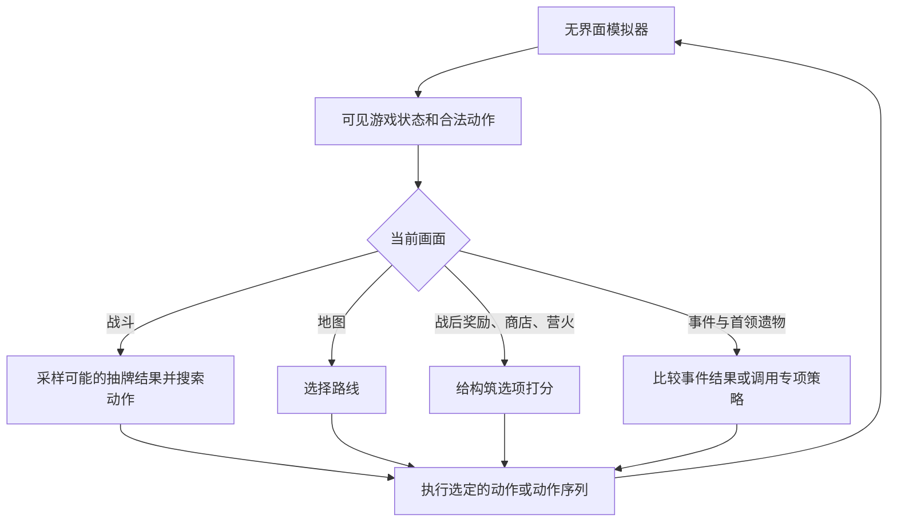

# Spire AI

[English](README.md) · 简体中文

Spire AI 是一个在无界面模拟器里玩《杀戮尖塔》的 AI。它能在一局中打战斗、选牌、
选路线，也会处理商店、营火和事件。项目目标是用铁甲战士击败进阶 10（A10）的
第三幕首领。战斗决策只使用玩家能看到的信息，战斗全程不读档（no SL）。

仓库提供模拟器运行入口、决策代码和训练好的模型权重，也提供能从新模拟对局继续训练的检查点。

## 发布版表现

| 模拟器评估 | 结果 |
| --- | --- |
| 用铁甲战士在 32 个 A10 种子上从头打 | 11 局通过第一幕，2 局到达第二幕首领，0 局通过第二幕或通关 |
| 从 52 个固定战斗局面开始，只打当前这一场 | 赢了 38 场 |

整局测试从开局开始，战斗、构筑、路线等策略都参与决策。单场测试从预先准备好的战斗局面
开始，只测战斗策略。我推测选牌构筑和路线等局外决策是当前的主要瓶颈，这还需要对照实验
验证。我近期能投入这部分优化的时间有限。

## 快速开始

已验证环境为 64 位 Windows、Python 3.11、CPU 版 PyTorch、MinGW-w64 GCC 13、
CMake 3.27 和 Ninja。将 Git、CMake、Ninja 和 MinGW 加入 `PATH`，然后在仓库根目录
打开 PowerShell，执行下面的命令。模拟器可以独立于 Steam 运行。

```powershell
python -m venv runtime/venv
$python = "runtime/venv/Scripts/python.exe"
& $python -m pip install torch==2.1.2 --index-url https://download.pytorch.org/whl/cpu
& $python scripts/build_native.py --jobs 4
& $python scripts/play.py --max-actions 12
```

如果 `sts_lightspeed/` 子模块及其依赖都已初始化到锁定版本，构建脚本会直接复用。
可以运行 `git submodule update --init --recursive` 初始化。否则构建脚本会使用
`runtime/sts_lightspeed`，需要时自动下载。编译产物放在 `runtime/native`。
也可以给 `scripts/build_native.py` 传入 `--source <path>`，使用指定目录中的锁定版本源码和依赖。
[模拟器版本锁定文件](src/spire_ai/simulator-lock.json)

试跑会为每个动作输出一行 JSON，最后输出 `{"actions": 12, "outcome": "action_limit"}`。
要从开局跑完整一局，可以执行下面的命令，最后一行会给出对局结果。

```powershell
& $python scripts/play.py --seed 20261125
```

## AI 怎么做决策



### 战斗

战斗策略受 AlphaZero 启发。一个模型引导蒙特卡洛树搜索优先尝试看起来较好的动作，另一个
模型在模拟未打到底时估计结果。《杀戮尖塔》还多了一层隐藏信息，比如不知道下一张会抽到什么。
[AlphaZero 论文](https://discovery.ucl.ac.uk/id/eprint/10069050/)

1. **采样可能的未来。** 如果已知抽牌堆顶是什么，每个样本都会把这张牌放在顶上，再根据
   其他公开线索生成未知的牌序。采样器会跟踪已支持的牌堆操作带来的约束，也会考虑同名牌的
   多个副本。实际的隐藏牌序和游戏种子由模拟器保管，战斗搜索无法读取。
   [公开状态接口](src/spire_ai/policy_api.py) · [牌序采样](native/combat_search/ObservedDrawPrefix.h)
2. **在多个样本里尝试合法动作。** C++ 搜索用 PUCT 根据模型推荐和已有结果分配访问次数。
   如果模拟经历了相同的动作和可见结果，就共享树里的统计。打到战斗结束时，搜索用实际结果
   更新统计；模拟提前停止时，由估值模型预测输、赢和逃跑的概率，以及可能剩下多少血量和药水价值。
   [搜索树](native/combat_search/StandaloneTree.h) · [估值模型](native/combat_search/ValueLeaf.h)
3. **执行一步，再根据看到的结果搜索。** 通常选择访问次数最多的动作。每次决策最多做
   1,024 次模拟、执行 16,384 个模拟动作。如果仅凭可见信息就能证明某个动作序列可以保住
   血量和药水并赢下战斗，也可以直接执行它的第一步。
   [动作选择](scripts/root_recommendation.py) · [终局证明](native/combat_search/TerminalProof.h)

### 战斗之外

- **卡组构筑。** 战后拿牌或跳过、在商店购买或删牌、在营火休息或升级，都用同一个构筑
  模型给选项打分。[构筑策略](src/spire_ai/construction_policy.py)
- **路线选择。** 单独的路线模型根据当前局面和路线特征为每个可走的出口分配概率，再按
  概率选一个出口。[路线策略](src/spire_ai/route_behavior.py)
- **事件选择。** 对符合条件且不会触发战斗的事件，模拟器可以从同一个入口状态重放不同
  选项，包括复用该事件起点的随机状态。构筑的估值模型比较各选项产生的可见结果。可能
  触发战斗的事件按正常对局推进。[事件搜索](src/spire_ai/local_event_search.py) ·
  [事件估值](src/spire_ai/local_event_value.py)

## 策略是怎么训练的

**战斗。** 负责推荐动作的模型也叫动作先验，它学习树搜索对各个合法动作的访问次数分布。
估值模型从打到底的战斗中学习。训练时用固定的战斗策略从采样局面出发，打完后记录终局
结果和剩余资源。后续轮次可以复用保存的公开局面，用该轮固定的战斗策略为两个模型
重新生成训练目标。

**局外。** 先从公开的《杀戮尖塔》玩家对局记录中提取能够还原的选择，做模仿学习。随后
固定战斗策略，在模拟器里生成新的整局轨迹，用 PPO（近端策略优化）更新卡组构筑和路线模型。
通过第一、第二、第三幕时分别追加 1、2、3 分，让开局的选牌和路线也能收到后续进度的反馈。
[人类对局数据来源](THIRD_PARTY_NOTICES.md)

公开训练入口可以用新对局继续做构筑和路线的 PPO，也可以用新战斗更新战斗先验和估值。
训练指南包含采集、保存、断点续训和配对评估命令。[续训指南](docs/training.md)

## 当前限制与后续训练

- **先改进构筑和路线。** 我会优先用整局结果检验构筑和路线的改动，期间固定战斗策略。路线
  模型的一个方向是传入整张后续可达地图，保留路径的分叉和汇合。从同一岔路走不同出口，
  后续策略固定，就能比较第一步选了不同路线会带来多大差别。
- **再补后期和成型卡组的战斗。** 目前第二、第三幕以及卡组配合成型的战斗数据较少。可以
  从新对局里采集这些局面，训练战斗模型发挥局外策略构筑的卡组。战斗估值对剩余药水的价值
  也仍是近似的。
- **模拟器覆盖。** 对局遇到暂未支持的机制时，运行可能报错终止。

后续对照可以在留出的种子和相同战斗搜索预算下，每次比较一项策略改动。用各幕通过率和
三幕通关率衡量进展，再用失血和药水消耗解释结果差异。

## 主要策略入口

| 决策 | 代码入口 |
| --- | --- |
| 整局调度 | [`FrozenPolicy.play`](scripts/play.py) |
| 战斗 | [`Combat.choose`](scripts/play.py)、[C++ 搜索树](native/combat_search/StandaloneTree.h) |
| 路线 | [`sample_route`](src/spire_ai/route_behavior.py) |
| 卡组构筑 | [`ConstructionPolicy`](src/spire_ai/construction_policy.py) |
| 事件和首领遗物 | [事件搜索](src/spire_ai/local_event_search.py)、[专项策略](src/spire_ai/canonical_event_dispatch.py) |

`scripts/` 放构建、运行命令和运行适配代码。可复用的 Python 策略与模拟器接口在
`src/spire_ai/`。C++ 战斗搜索在 `native/combat_search/`。训练好的权重和加载配置放在
`models/`。[模型清单](models/manifest.json)

项目采用 MIT 许可证。第三方说明列出了模拟器依赖和人类对局数据来源。
[许可证](LICENSE) · [第三方说明](THIRD_PARTY_NOTICES.md)
